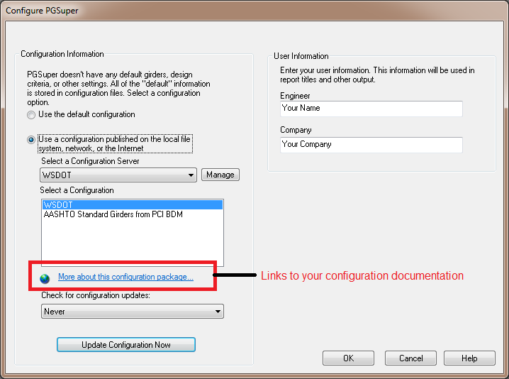

Configuration Servers {#configuration_server_files}
============
Configuration Servers are more of a concept than what we traditionally think of as a server. The Configuration Servers we are talking about are basically locations where some files can be stored and accessed by users.

Our Configuration Servers can use a local disk on your computer, a network file system, or an HTTPS web server to store and provide access to Configurations.

In this topic we will describe how to setup configuration servers.

Local and Network File System based Configuration Servers
----------------------------------------------------------
Configuration Servers based on a file system are the easiest to setup, however the accessibility is limited. Generally, you do not have your file system shared on the Internet for everyone to use. File system based configuration servers are useful when developing configurations or when working with specialized non-standard information that must be shared to a limited group.

To set up the server:
1. Determine the location on your file system where you would like the server to reside. Let's say G:\\PGSuper\\.
2. Copy your Master Library to G:\\PGSuper\\. The Master Library is a file you create with the PGSLibrary Editor application. The file has a .LBR extension.
3. Copy your Project Templates, including the folder structure, to G:\\PGSuper\\. See @ref project_templates to learn how to create and organize project templates.
4. Let everyone know how to access your configuration.

> NOTE: Local and Network File System based servers do not use publishing instructions or configuration documentation.

See @ref ug_configurations in the @ref user_guide to learn how to configure PGSuper and PGSplice to use a file system based configuration. You will want to provide your users with the following information that is to be entered in the Configuration Server Definition window.

Item | Value
-----|----------
Name | This can be any name. Specify one or let your users decide
Server Type | Local or Network File System
Master Library File | The full path to your Master Library file. (e.g. G:\\PGSuper\\MasterLibrary.lbr)
Path to Template Files | The full path to root folder for your Project Templates. (e.g. G:\\PGSuper\\)

PGSuper and PGSplice check this kind of server for updates using checksum lists next to the Master Library and in the template folder. If the lists are missing, the configuration is copied again at every update check. Create the lists with ConfigPackager:

    ConfigPackager.exe /Md5List G:\PGSuper\MasterLibrary.lbr G:\PGSuper\MasterLibrary.lbr.md5
    ConfigPackager.exe /Md5List G:\PGSuper\ G:\PGSuper\WorkgroupTemplates.md5

Run these commands again whenever you change the Master Library or the Project Templates.

HTTPS and Network Folder based Configuration Servers
----------------------------------------------------
Configurations that are shared over the Internet are published on an HTTPS web server. The same files can also be published in a folder on your network.

A configuration server of this type holds three kinds of files:
* Configuration Packages - one file for each configuration and program version, containing the Master Library and Project Templates
* The list of configurations - a file named ConfigurationPackages.json that tells PGSuper and PGSplice which configurations you publish, and where to find their packages
* Configuration Documentation (optional) - a web page about each configuration

> NOTE: Web servers must use HTTPS (addresses that start with https://). FTP servers are no longer supported.

### Configuration Documentation ###
Let's start by writing the configuration documentation. This is simply an HTML page that contains information about your configuration. The documentation often contains the following information:
* Description
* Publishing Date
* Warnings and Limitations
* Support contact information
* Revision log

The configuration documentation must be placed on a web server so users can read it. The location of the configuration documentation is recorded in the list of configurations as described below. The @ref ug_dialogs_configure window has a hyperlink that, when pressed, will display your configuration documentation.

### Building the Configuration Package ###
The Master Library and Project Templates are placed into a Configuration Package that is stored on the configuration server. The configuration package allows the software to download a single file when installing a configuration rather than downloading the Master Library file and one additional file for each Project Template.

A configuration package is a standard zip file. Give it a .zip extension. Web servers deliver .zip files without any extra settings. (Packages published with the older .pgz extension still work.)

The ConfigPackager.exe utility program is installed with PGSuper and PGSplice. It can be found in the BridgeLink application folder. ConfigPackager creates the Configuration Package. (ConfigPackager was called MakePgz in earlier versions.)

To make a configuration package use the command

     ConfigPackager.exe package_file master_library_file project_template_folder template_extension

where

Parameter | Description
----------|------------
package_file | The name of the Configuration Package that will be created (e.g. MyState.zip)
master_library_file | The name of your Master Library file
project_template_folder | The name of the root folder for your project templates. This folder is searched recursively for all project templates
template_extension | The file extension for your templates (PGT for PGSuper and SPT for PGSplice)

Example:

    "C:\Program Files\WSDOT\BridgeLink\ConfigPackager.exe" C:\Publish\PGSuper\9.1.0\MyState.zip C:\PGSuper\MyState.lbr C:\PGSuper\MyTemplates PGT

ConfigPackager also writes MyState.zip.md5. You only need to publish this file if you also publish an INI file for older program versions (see below).

### The List of Configurations ###
Next we create the list of configurations. It is a text file named ConfigurationPackages.json. One file lists the configurations for PGSuper and PGSplice (and TOGA), so a server needs only one.

Here is an example.

    {
      "schemaVersion": 1,
      "applications": {
        "PGSuper": {
          "configurations": [
            {
              "name": "MyState",
              "webLink": "https://www.mystate.gov/bridge/PGSuper/MyState.html",
              "packages": [
                { "appVersion": "9.0.0", "url": "PGSuper/9.0.0/MyState.zip", "md5": "9e107d9d372bb6826bd81d3542a419d6" },
                { "appVersion": "9.1.0", "url": "PGSuper/9.1.0/MyState.zip", "md5": "e4d909c290d0fb1ca068ffaddf22cbd0" }
              ]
            }
          ]
        },
        "PGSplice": {
          "configurations": [
            {
              "name": "MyState",
              "packages": [
                { "appVersion": "9.1.0", "url": "PGSplice/9.1.0/MyState.zip", "md5": "d41d8cd98f00b204e9800998ecf8427e" }
              ]
            }
          ]
        }
      }
    }

Field | Description
------|-----------
schemaVersion | Version of the file format. Use 1.
applications | One section for each program: PGSuper, PGSplice or TOGA. Leave out programs you don't publish configurations for.
name | Name of the configuration. This is the name users see in the Configure window.
webLink | URL of the configuration documentation. Omit if configuration documentation is not used.
appVersion | The lowest program version the package is for, in the form x.y.z
url | Location of the configuration package. A relative location, such as PGSuper/9.1.0/MyState.zip, is relative to the folder that holds ConfigurationPackages.json. A full address must start with https://.
md5 | Checksum of the configuration package. PGSuper and PGSplice use it to tell when a configuration has changed and to verify downloads. ConfigPackager fills it in.

When installing a configuration, PGSuper will look for the configuration package with the highest version number that is not greater than its own version number. If you use PGSuper Version 9.0.5, the configuration package for version 9.0.0 will be installed.

You don't need to write this file by hand. ConfigPackager creates and updates it:

Command | What it does
--------|-------------
ConfigPackager.exe /AddPackage ConfigurationPackages.json PGSuper "MyState" 9.1.0 PGSuper\\9.1.0\\MyState.zip /WebLink=https://www.mystate.gov/bridge/PGSuper/MyState.html | Adds the package for PGSuper 9.1.0 to the MyState configuration, with its checksum. The file is created if it doesn't exist. The package location is written relative to the JSON file.
ConfigPackager.exe /UpdateMd5 ConfigurationPackages.json | Recomputes the checksum of every package stored with the JSON file. Run it after replacing a package.
ConfigPackager.exe /Check ConfigurationPackages.json | Checks the file before you publish it: format, version numbers, addresses, and that each package is present and matches its checksum.
ConfigPackager.exe /Convert ConfigurationPackages.json PGSuperPackages.ini PGSplicePackages.ini /Base=https://www.mystate.gov/bridge/ | Creates the file from existing INI files (see below). Package addresses under the /Base address become relative.

> NOTE: The file must be valid JSON. A typing mistake anywhere in the file stops every program from reading it, so always run ConfigPackager /Check before publishing.

### Publishing your Configuration ###
Your configuration is now ready to be published on the configuration server and used by engineers all around the world.

To publish your configuration:
1. Copy the configuration documentation onto your web server.
2. Copy ConfigurationPackages.json and the configuration packages to the server, keeping the folder structure used by the relative package locations (e.g. PGSuper\\9.1.0\\MyState.zip).
3. Let everyone know how to access your configuration.

See @ref ug_configurations in the @ref user_guide to learn how to configure PGSuper and PGSplice to use your configuration server. You will want to provide your users with the following information that is to be entered in the Configuration Server Definition window.

Item | Value
-----|----------
Name | This can be any name. Specify one or let your users decide
Server Type | Internet HTTPS Server, or Local or Network File System Using ConfigurationPackages.json for a network folder
Server Address (URL) | The address of the folder that holds ConfigurationPackages.json (e.g. https://www.mystate.gov/bridge/), or the full address of the JSON file. For a network folder, the folder path.

### Web Server Settings ###
Most web servers deliver .json and .zip files without any extra settings. Some web servers, including Microsoft IIS, refuse to deliver file types they don't recognize, such as .ini, .pgz and .md5. If you must serve those files from IIS (for example, the INI files described below), add a web.config file to the folder:

    <?xml version="1.0" encoding="UTF-8"?>
    <configuration>
      <system.webServer>
        <staticContent>
          <remove fileExtension=".ini" />
          <mimeMap fileExtension=".ini" mimeType="text/plain" />
          <remove fileExtension=".pgz" />
          <mimeMap fileExtension=".pgz" mimeType="application/zip" />
          <remove fileExtension=".md5" />
          <mimeMap fileExtension=".md5" mimeType="text/plain" />
        </staticContent>
      </system.webServer>
    </configuration>

Your web server administrator may need to allow web.config files in that folder.

### Older Program Versions ###
Program versions released before ConfigurationPackages.json was introduced read a different file: PGSuperPackages.ini (PGSplicePackages.ini for PGSplice, TOGAPackages.ini for TOGA). If your users still run those versions, keep publishing the INI files next to ConfigurationPackages.json. Current program versions read ConfigurationPackages.json when it is there, and read the INI file when it isn't.

Here is an example INI file.

    [MyState]
    WebLink="https://www.mystate.gov/bridge/PGSuper/MyState.html"
    Format="pgz"
    Version_9.0.0_PgzFiles="https://www.mystate.gov/bridge/PGSuper/9.0.0/MyState.zip"
    Version_9.1.0_PgzFiles="https://www.mystate.gov/bridge/PGSuper/9.1.0/MyState.zip"

Keyword | Description
--------|-----------
[MyState] | The configuration name
WebLink | URL of the configuration documentation. Omit if configuration documentation is not used.
Format  | Format of the configuration package. "pgz" is the only valid value
Version_x.y.z_PgzFiles | Full address of the configuration package for program version x.y.z

Older program versions check for configuration changes with a checksum file next to each package (MyState.zip.md5, written by ConfigPackager). Publish those files with the INI file. See Web Server Settings above if your server refuses .ini or .md5 files.
