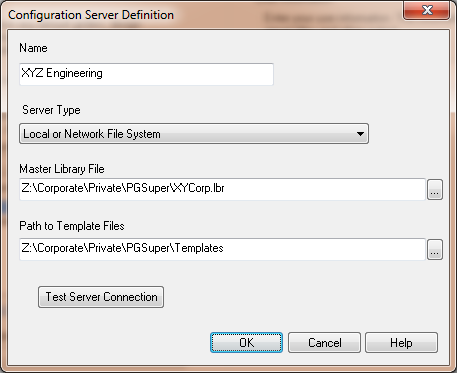
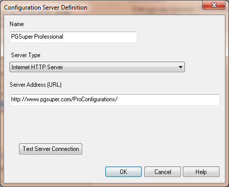
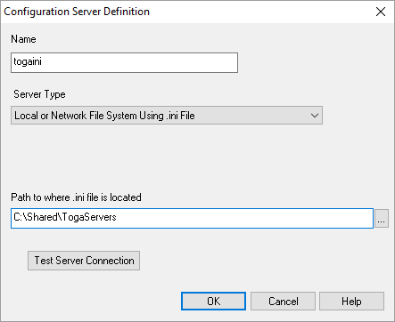

Configuration Server Definition {#ug_dialogs_configuration_server_definition}
==============================================
Define a Configuration Server. 

Item | Description
-----|------------
Name | Enter a name for the server definition
Server Type | Select the server type
Server Address (URL) | Enter the address of the server (see examples below). The address must start with https://
Master Library File | Enter the location of the master library file (see examples below)
Path to Template Files | Enter the path to the template files (see examples below)
Folder containing ConfigurationPackages.json | Enter the folder that holds the list of configurations (see examples below)
[Test Server Connection] | Press to test the connection with the server

Example Configurations
---------------

### Local or Network File System ###
This type of server is typically used on a computer that is not on a network or for a group of users who want to keep their configuration private from the rest of the world.

### Internet HTTPS Server ###
This type of server is typically used to share a configuration across the internet. Enter the address of the folder that holds the configurations, or the full address of the configuration server's .json file. The address must start with https://.

> NOTE: FTP servers are no longer supported. Servers that were defined with an FTP or http:// address continue to work when the same location is available over https://, and the address is updated automatically.

### Local or Network File System Using ConfigurationPackages.json ###
This type of server uses a folder on your computer or network that holds the list of configurations (ConfigurationPackages.json) and configuration packages. This has advantages over the normal file system server by allowing multiple configurations at one network location, and versioning of the configurations. Refer to @ref configuration_server_files for information about how to create these files.

