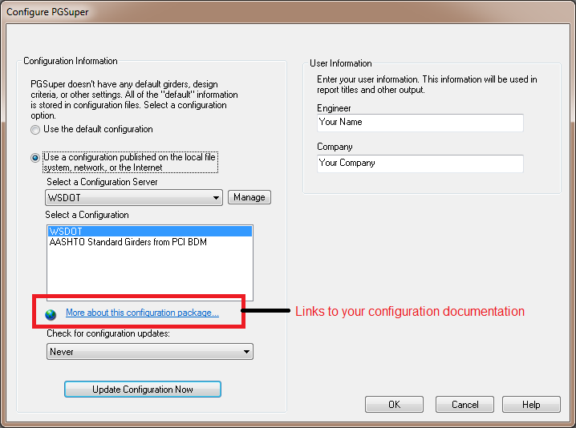

Configuration Servers - The Details {#configuration_server_files}
============
Configuration Servers are more of a concept than what we traditionally think of as a server. The Configuration Servers we refer to are basically locations where some files can be stored and accessed by users.

Our Configuration Servers can use a local or network file system on your computer, or an HTTPS web server to store and provide access to Configurations.

In this topic we will describe how to setup configuration servers.

Local and Network File System based Configuration Servers
----------------------------------------------------------
Configuration Servers based on a file system are the easiest to setup, however the accessibility is limited to a LAN/WAN. Generally, you do not have your file system shared on the Internet for everyone to use (although it may work on DropBox or Google Drive, we have not tested this). File system based configuration servers are useful when developing configurations or when working with a limited group.

To set up the server:
1. Determine the location on your file system where you would like the server to reside. Let's say G:\\MyTOGA\\.
2. Copy your Master Library to G:\\MyTOGA\\. The Master Library is a file you create with the PGS Library Editor application. The file has a .LBR extension.
3. Create a folder for template files, let's say G:\\MyTOGA\\MyTemplates\\
4. Copy your TOGA Project Templates (*.togt), icon files (*.ico) and TogaTemplate.pgs to G:\\MyTOGA\\MyTemplates. 
5. Let everyone know how to access your configuration.

> NOTE: Local and Network File System based servers do not use publishing instructions or configuration documentation.

See @ref configurations in the @ref adminstrator_guide to learn how to configure TOGA to use a file system based configuration. You will want to provide your users with the following information that is to be entered in the Configuration Server Definition window.

Item | Value
-----|----------
Name | This can be any name. Specify one, or let your users decide
Server Type | Local or Network File System
Master Library File | The full path to your Master Library file. (e.g. G:\\MyTOGA\\MasterLibrary.lbr)
Path to Template Files | The full path to the folder containing your Project Templates. (e.g. G:\\MyTOGA\\MyTemplates\\). The TOGA Project Templates folder contains all of your templates (*.togt), icon files (*.ico) and TogaTemplate.pgs

TOGA checks this kind of server for updates using checksum lists. If the lists are missing, the configuration is copied again at every update check. Create the lists with ConfigPackager, and run the commands again whenever you change the files:

    ConfigPackager.exe /Md5List G:\MyTOGA\MasterLibrary.lbr G:\MyTOGA\MasterLibrary.lbr.md5
    ConfigPackager.exe /Md5List G:\MyTOGA\MyTemplates\ G:\MyTOGA\MyTemplates\WorkgroupTemplates.md5

HTTPS and Network Folder based Configuration Servers
----------------------------------------------------
Configurations that are shared over the Internet are published on an HTTPS web server. The same files can also be published in a folder on your network. A configuration server of this type holds configuration packages, a list of configurations named ConfigurationPackages.json, and optional configuration documentation.

> NOTE: Web servers must use HTTPS (addresses that start with https://). FTP servers are no longer supported.

### Configuration Documentation ###
Let's start by writing the optional configuration documentation. This is simply an HTML page that contains information about your configuration. You can create any web page you want, but the documentation generally should contain the following information:
* Description
* Publishing Date
* Warnings and Limitations
* Support contact information
* Revision log

The configuration documentation must be placed on a web server where users can access it. The location of the configuration documentation is recorded in the list of configurations as described below. The @ref dialogs_configure window has a hyperlink that, when pressed, will display your configuration documentation.

### Building the Configuration Package ###
The Master Library and Project Templates must be placed into a Configuration Package that will be stored on the configuration server. The configuration package allows the software to download a single file when installing a configuration, rather than downloading the Master Library file and additional files for each Project Template. A configuration package is a standard zip file; give it a .zip extension. (Packages with the older .pgz extension still work.)

The ConfigPackager.exe utility program was installed with BridgeLink. It can be found in the BridgeLink application folder. ConfigPackager creates the Configuration Package. (ConfigPackager was called MakePGZ in earlier versions.)

To make a configuration package, use the command:

     ConfigPackager.exe package_file master_library_file project_template_folder TOGT PGS

where

Parameter | Description
----------|------------
package_file | The name of the TOGA Configuration Package that will be created (e.g. MyState.zip)
master_library_file | The name of your Master Library file
project_template_folder | The name of the folder containing your project templates (*.togt files), icon files (*.ico) and TogaTemplate.pgs. 
TOGT PGS | The file extension for your templates and pgs file (use TOGT PGS literally)

Example:

    "C:\Program Files\WSDOT\BridgeLink\ConfigPackager.exe" C:\Publish\TOGA\9.1.0\MyState.zip  G:\MyTOGA\MasterLibrary.lbr  G:\MyTOGA\MyTemplates\ TOGT PGS

This command also writes C:\\Publish\\TOGA\\9.1.0\\MyState.zip.md5. You only need to publish that file if you also publish a TOGAPackages.ini file for older versions of TOGA (see below).

> Note: The template folder is a single folder containing all of your *.togt files, *.ico files, and TogaTemplate.pgs. This is unlike how a multi-folder structure is used in PGSuper or PGSplice templates. Also, note that ConfigPackager does not verify that all of the files necessary to run TOGA are present.

### The List of Configurations ###
Next, we have to create the list of configurations, a text file named ConfigurationPackages.json. Here is an example:

    {
      "schemaVersion": 1,
      "applications": {
        "TOGA": {
          "configurations": [
            {
              "name": "MyState",
              "webLink": "https://www.mystate.gov/bridge/TOGA/MyState.html",
              "packages": [
                { "appVersion": "9.0.0", "url": "TOGA/9.0.0/MyState.zip", "md5": "9e107d9d372bb6826bd81d3542a419d6" },
                { "appVersion": "9.1.0", "url": "TOGA/9.1.0/MyState.zip", "md5": "e4d909c290d0fb1ca068ffaddf22cbd0" }
              ]
            }
          ]
        }
      }
    }

The same file can also list configurations for PGSuper and PGSplice, in their own sections.

Field | Description
------|-----------
schemaVersion | Version of the file format. Use 1.
applications | One section for each program (TOGA, PGSuper, PGSplice)
name | Name of the configuration. This is the name users see in the Configure window.
webLink | URL of the configuration documentation. Omit if configuration documentation is not used.
appVersion | The lowest TOGA version the package is for, in the form x.y.z
url | Location of the configuration package. A relative location is relative to the folder that holds ConfigurationPackages.json. A full address must start with https://.
md5 | Checksum of the configuration package, used to tell when a configuration has changed. ConfigPackager fills it in.

When installing a configuration, TOGA will look for the configuration package with the highest version number that is not greater than its own version number. If you use TOGA Version 9.0.5, the configuration package for version 9.0.0 will be installed.

ConfigPackager creates and checks this file for you:

    ConfigPackager.exe /AddPackage C:\Publish\ConfigurationPackages.json TOGA "MyState" 9.1.0 C:\Publish\TOGA\9.1.0\MyState.zip /WebLink=https://www.mystate.gov/bridge/TOGA/MyState.html
    ConfigPackager.exe /Check C:\Publish\ConfigurationPackages.json

To create the file from an existing TOGAPackages.ini file:

    ConfigPackager.exe /Convert C:\Publish\ConfigurationPackages.json C:\Publish\TOGAPackages.ini /Base=https://www.mystate.gov/bridge/
    ConfigPackager.exe /UpdateMd5 C:\Publish\ConfigurationPackages.json

> NOTE: A typing mistake anywhere in the file stops TOGA from reading it, so always run ConfigPackager /Check before publishing.

### Publishing your Configuration ###
Your configuration is now ready to be published on the configuration server and accessed by engineers all around the world.

To publish your configuration:
1. Copy the configuration documentation onto your web server.
2. Copy ConfigurationPackages.json and the configuration packages to the server, keeping the folder structure used by the relative package locations.
3. Let everyone know how to access your configuration.

See @ref configurations to learn how to configure TOGA to use your configuration server. You will want to provide your users with the following information that is to be entered in the Configuration Server Definition window.

Item | Value
-----|----------
Name | This can be any name. Specify one or let your users decide
Server Type | Internet HTTPS Server, or Local or Network File System Using ConfigurationPackages.json for a network folder
Server Address (URL) | The address of the folder that holds ConfigurationPackages.json (e.g. https://www.mystate.gov/bridge/). For a network folder, the folder path.

### Older Versions of TOGA ###
Versions of TOGA released before ConfigurationPackages.json was introduced read TOGAPackages.ini instead. If your users still run those versions, keep publishing TOGAPackages.ini, and the .md5 file for each package, next to ConfigurationPackages.json. Current versions of TOGA read ConfigurationPackages.json when it is there, and read TOGAPackages.ini when it isn't.

    [MyState]
    WebLink="https://www.mystate.gov/bridge/TOGA/MyState.html"
    Format="pgz"
    Version_9.0.0_PgzFiles="https://www.mystate.gov/bridge/TOGA/9.0.0/MyState.zip"
    Version_9.1.0_PgzFiles="https://www.mystate.gov/bridge/TOGA/9.1.0/MyState.zip"

Some web servers, including Microsoft IIS, refuse to deliver .ini and .md5 files unless they are configured to. See the PGSuper Administrator Guide (Configuration Servers) for a sample web.config file.
